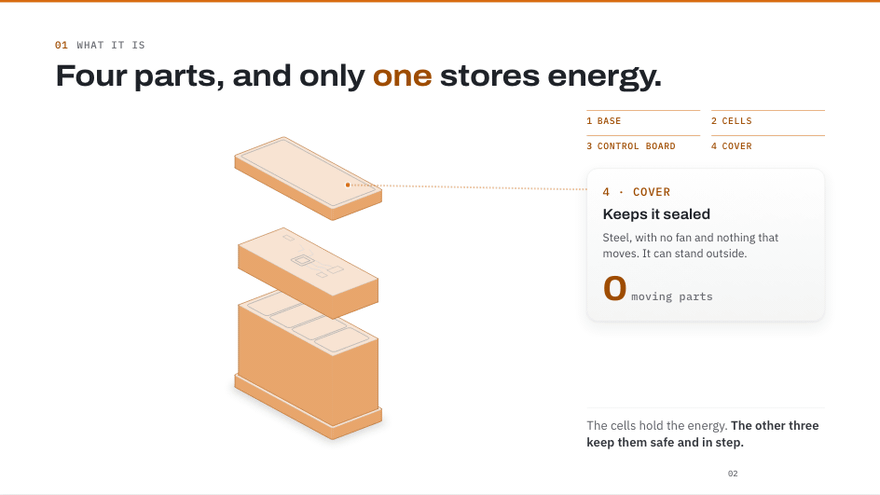
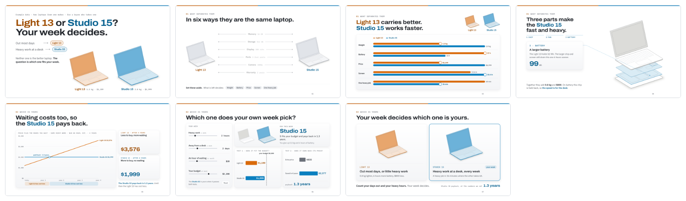
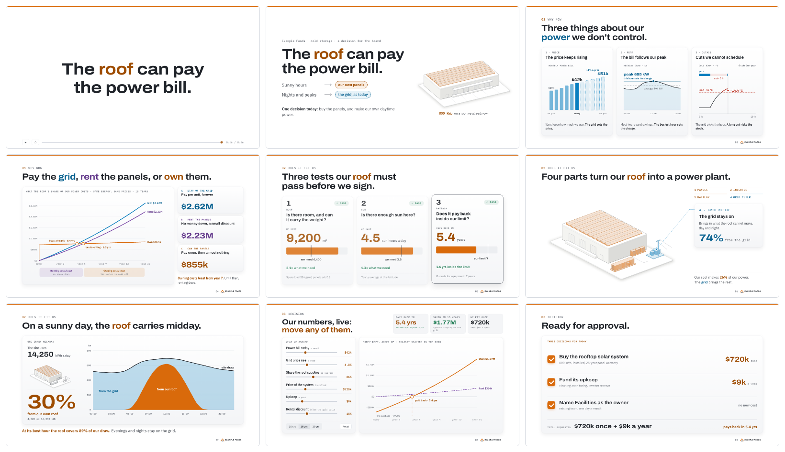
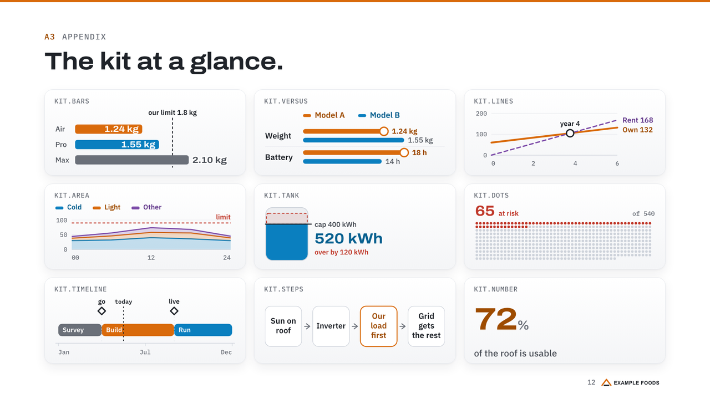

# PresentToMe

The storytelling method of Wai (Suppanimit Meemungkit), packaged as an agent skill. It makes a hard subject easy to understand by telling it as an interactive presentation.

Ask your coding agent for a presentation and it does three things. It finds the story first. It tells the story in the shape of a martini glass: a narrow stem where the presenter leads one idea at a time, then a wide mouth where the audience explores. And it uses design to carry the explanation: raised white cards, colour that means something, motion on every key press, drawn charts, 3D anatomy figures, numbers the room can tune live, and objects that travel from one slide into the next.

The result runs in a browser and ships as one offline HTML file. It works in Claude Code, Codex, Cursor, Gemini CLI, GitHub Copilot and any other agent that reads [Agent Skills](https://agentskills.io).

[ภาษาไทย](README.th.md)



Every slide on this page comes from the decks that ship with the skill. Their stories and every number in them are invented.

## You start from a finished deck

Version 1.0 gave the agent a blank deck and eleven guides. Agents with a one-line request built pages of text in boxes. Version 1.1 gives the agent a finished deck of the right kind, with every part of the design kit already wired and moving. The agent retells it for your story.

| Kind | For a request like | What it starts with |
|---|---|---|
| `explainer` | "Explain how X works", "slides about X" | The thing as a 3D figure, its parts one per press, where it goes, the process, the numbers, the limit, a slide the room can try |
| `versus` | "X or Y", "X vs Y" | Both things side by side, what is the same, the rows that differ, what differs inside, the cost over time, a chooser, the verdict |
| `decision` | "Get this approved" | A film opener, why now, options on one basis, tests, how it works, live money, the ask |
| `blank` | Anything else | A title, questions and sources, with templates for the rest |






## The story comes first

How a talk is told matters more than how it looks, so the skill starts with the story and makes every design choice serve it.

- **Grill with me.** Before any slide, the agent interviews you, one question at a time, each with its own best guess. It keeps asking until it knows who decides, what they should do, and the one sentence they should remember.
- **A Story Brief and a storyboard you approve.** Eight lines, then a slide list where every title is a claim and every slide names the picture that proves it.
- **The martini glass.** The stem comes first. You lead the room along one path, one idea and one press at a time, until everyone understands the same thing. Then the mouth opens. The audience asks, you move a slider or open an appendix page, and the deck answers. No control appears before the claim it tests has been made. The shape is the one Segel and Heer describe in [Narrative Visualization: Telling Stories with Data](https://idl.uw.edu/papers/narrative).
- **An arc for each kind of talk.** An explainer goes from the outside of a thing to its inside to its use. A versus removes everything that does not separate the two. A decision puts the outside world before the proposal and the ask after every number in it has been seen.
- **One press, one sentence.** Each key press reveals what you say next, so the audience listens to you and does not read ahead.

## The design kit

Seven parts. Each one has a ready-made way to build it, so the agent spends its effort on your story.

**Raised white cards.** One idea per card: a small tag, a short heading, one drawing, one line.


**Colour with meaning.** Three colours, each with one meaning for the whole deck. Titles, lines and figures use the same three, so a chart needs no legend.

**Motion on every press.** Lines draw, bars grow, a tank fills, parts lift apart. Each movement shows an order or a cause that a still picture would leave the audience to work out.

**Drawn visuals.** Nine chart components in the house style, each animated and each a few lines to use: bars, versus rows, lines that cross, stacked areas, a tank, dots, a timeline, steps, one big number.



**3D anatomy.** A thin-line isometric drawing of the real thing, with parts that light up and move apart one per press. Eight presets cover most subjects: a laptop, a phone, a tower, a rack, a building, a box, a column and a stack of layers.


**Parameters you can tune live.** This is the mouth of the martini glass. One model file owns every number, so when a slider moves, the chart, the tiles and every later slide follow.


**Continuity.** The same object or number travels from one slide into the next, like a morph transition. The machine on one slide moves into the room on the next. The number computed on one slide becomes a line of the ask. The story reads as one movement.


## A check that holds the bar

`npm run check` opens every slide at every press in a real browser. It fails on script errors, missing files, clipped text and content that leaves the stage. It also measures the design kit, and fails a deck that lost it.

| Rule | What it measures |
|---|---|
| Every slide has a picture | A drawing or a 3D figure that fills 6% of the stage or more |
| Photos are evidence | A photograph is the only picture on two slides at most |
| The deck has a 3D figure | At least one scene on a slide |
| The room can change something | A slider, a select or a choice |
| Something travels between slides | Morphs that really fly, counted in the browser |
| Every press moves the drawing | Each slide with presses has a hook or a kit component |
| The house style is kept | No dark slide, and raised cards in use |

A rule that does not fit a deck can be switched off in the deck's config with a written reason. The agent is told to report every such allowance to you.

## Install

**Any agent, with the `skills` CLI**

```bash
npx skills add consciencex/PresentToMe
```

Add `-g` to install for your user account, and `-a <agent>` to pick one agent (`claude-code`, `codex`, `cursor`, `gemini-cli`, `github-copilot`, `opencode`, `amp`, `goose`, `windsurf`).

**Claude Code, as a plugin**

```
/plugin marketplace add consciencex/PresentToMe
/plugin install present-to-me@presenttome
```

**Codex**

```bash
npx skills add consciencex/PresentToMe -a codex -g
```

**Gemini CLI**

```bash
gemini skills install https://github.com/consciencex/PresentToMe.git --path skills/present-to-me
```

**By hand.** Copy the folder `skills/present-to-me` into your agent's skills folder: `~/.claude/skills/` for Claude Code, `~/.agents/skills/` for Codex and most others.

Requirements: Node.js 20 or later. The check and the screenshot tools use Playwright with Chromium, installed in the deck folder.

## Use

Ask for a presentation in your own words.

> Explain how a heat pump works to homeowners. Ten minutes. Thai slides.

> Make slides comparing our two laptop models for the sales team.

> Make a 15-minute deck for our board on moving the warehouse to solar. The quote and last year's bills are in ./docs.

The agent reads what you gave it, asks its questions, shows you the brief and the slide list, then retells the deck slide by slide and shows you screenshots as it goes.

To look at a deck yourself:

```bash
node skills/present-to-me/scripts/new-deck.mjs ./my-deck --kind explainer
cd my-deck
npm install
npm run dev        # http://localhost:5173
```

Keys: → next, ← back, N notes, M menu, P presenter window, F full screen.

## What the tools do on your computer

The skill was reviewed for safety before release, and its tools are covered by tests in `tests/`.

- The deck has no runtime dependencies. `npm install` adds only Playwright, pinned to one version, for the check and the screenshots. The agent is told to ask you before installing anything or downloading the browser.
- The preview and the check serve files on this computer only (127.0.0.1), and only from the build folder.
- The build never empties a folder. It removes only files its own previous run wrote, and refuses a folder that holds anything else.
- `new-deck.mjs` writes only into a new or empty folder.
- Speaker notes stay in `dist/`. `npm run build:public` writes a copy without notes to `public-build/` for anything other people will open.
- The font tool fetches from Google Fonts over https and from nowhere else. No third-party logo ships with the skill.
- The agent is told not to commit, publish or send anything unless you ask.

## What is in the skill

```
skills/present-to-me/
├── SKILL.md                        the kinds, the kit, the bar, the workflow, the rules
├── references/
│   ├── grill-with-me.md            the interview and the Story Brief
│   ├── story.md                    the arcs, the martini glass, continuity, titles
│   ├── kit-components.md           the nine chart components, with an example each
│   ├── slide-patterns.md           thirty-five patterns: layout, presses, technique, what goes wrong
│   ├── anatomy-3d.md               3D figures: presets, Kit.figure, writing a scene
│   ├── motion-and-interaction.md   presses in any order, morphs, timings, live numbers
│   ├── visual-style.md             raised cards, colour, type, keeping the house style
│   ├── numbers-and-comparisons.md  one home for every number, like with like
│   ├── logos-and-sources.md        real logos used properly, source lines, the registry
│   ├── notes-and-presenting.md     speaker notes, second-language scripts, rehearsal, film openers
│   ├── build-check-ship.md         commands, messages, the check and its rules, sharing, privacy
│   └── pitfalls.md                 what went wrong on real decks, and what to do
├── scripts/new-deck.mjs            starts a deck of one kind
└── assets/
    ├── starter/                    the engine, the kit, the tools, the templates, and the decision deck
    └── recipes/                    the explainer deck and the versus deck
```

## Where it comes from

The method is Wai's. The skill was distilled from building one long executive deck with it over several weeks: 75 slides, many rounds of correction from the person presenting it, and a growing list of what worked and what did not. The story method, the design kit and the pitfalls here are that list, with the confidential content removed and the engine rewritten as a general starter.

## Credits

- Isometric figures use a vendored subset of [Anatomy](https://github.com/wheresryan22/anatomy) by Ryan (MIT). For detailed illustration, look at Anatomy itself.
- The default typefaces are Archivo, IBM Plex Sans and IBM Plex Mono (SIL Open Font License), loaded from Google Fonts. Thai decks add IBM Plex Sans Thai.
- See [THIRD_PARTY_NOTICES.md](THIRD_PARTY_NOTICES.md).

## Licence

MIT. See [LICENSE](LICENSE).
