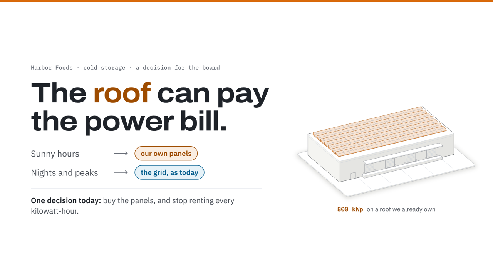
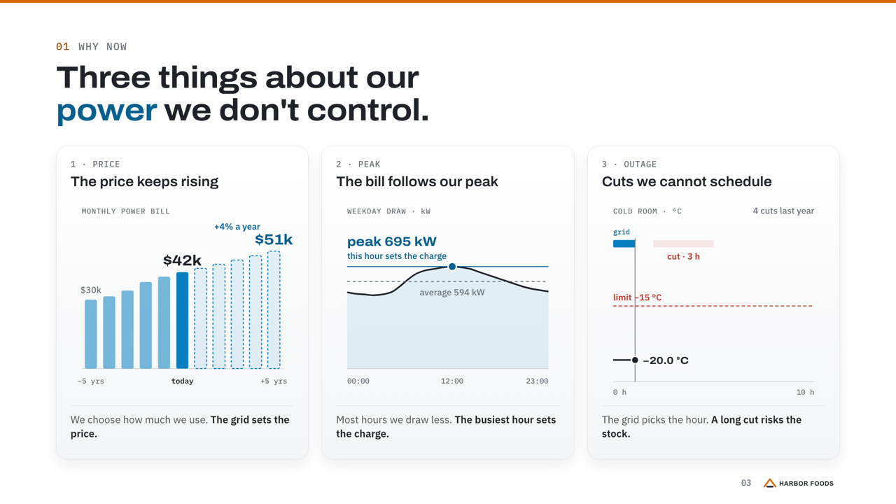
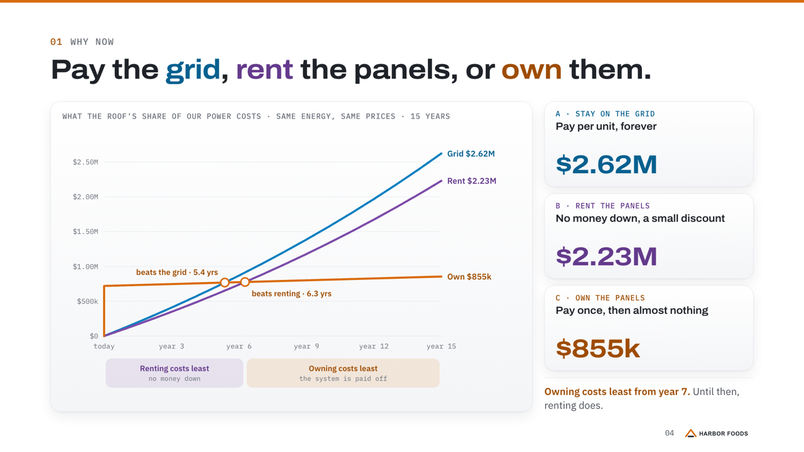
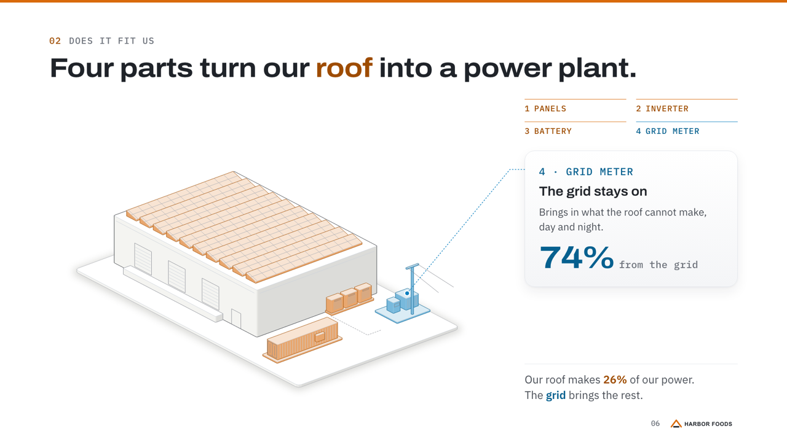
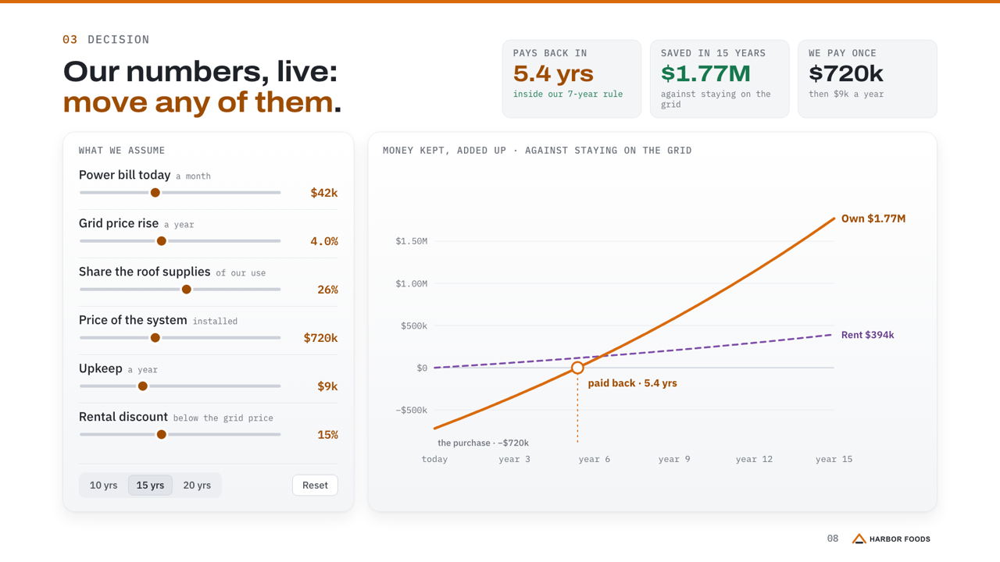

# PresentToMe

An agent skill that builds presentations people can follow: a story first, then slides that reveal one thing per key press, with charts drawn from a live model, isometric 3D figures, real logos, speaker notes, and one HTML file that runs offline.

It works in Claude Code, Codex, Cursor, Gemini CLI, GitHub Copilot and any other agent that reads [Agent Skills](https://agentskills.io).

[ภาษาไทย](README.th.md)



| | |
|---|---|
|  |  |
|  |  |

These are slides from the example deck that ships with the skill. Its story and every figure in it are invented.

## What you get

- **Grill with me.** Before any slide, the agent interviews you: one question at a time, each with its best guess, until the audience, the decision and the one sentence are clear. You approve a Story Brief and a slide list before anything is built.
- **A deck that runs in the browser.** One slide per file on a 1920 × 1080 stage. → reveals the next thing. N shows notes, P opens a presenter window, M opens the menu.
- **Pictures that carry the point.** Thirty slide patterns: raised cards with one drawing each, cost lines that cross, test strips, tanks, gauges, exploded figures, a live calculator, an approval checklist that ticks itself, a film opener.
- **Numbers you can defend.** One model file owns every number. Slides bind to it, sliders change it, and every later slide follows. Sources are collected into the appendix by the build.
- **Isometric figures.** Thin-line 3D drawings of the real thing, with parts that light up and move apart.
- **Checks.** A build that reports mistakes, and a browser check that opens every slide at every press and fails on errors, clipped text and content that leaves the stage.
- **A deck memory.** `DECK.md` holds the brief, the colour dictionary and a log of your decisions, so the next session continues where this one stopped.

## Install

**Any agent, with the `skills` CLI**

```bash
npx skills add consciencex/PresentToMe
```

Add `-g` to install for your user account, and `-a <agent>` to pick one agent (`claude-code`, `codex`, `cursor`, `gemini-cli`, `github-copilot`, `opencode`, `amp`, `goose`, `windsurf`).

**Claude Code, as a plugin**

```
/plugin marketplace add consciencex/PresentToMe
/plugin install present-to-me@presenttome
```

**Codex**

```bash
npx skills add consciencex/PresentToMe -a codex -g
```

**Gemini CLI**

```bash
gemini skills install https://github.com/consciencex/PresentToMe.git --path skills/present-to-me
```

**By hand.** Copy the folder `skills/present-to-me` into your agent's skills folder: `~/.claude/skills/` for Claude Code, `~/.agents/skills/` for Codex and most others.

Requirements: Node.js 20 or later. The automated check and the screenshot tools use Playwright with Chromium, which the agent installs in the deck folder when needed.

## Use

Ask for a presentation in your own words.

> Make a 15-minute deck for our board on moving the warehouse to solar. The quote and last year's bills are in ./docs.

> I need to explain our new pricing to the sales team on Friday. Grill me first.

> Turn this report into slides for the CEO. English slides, I will speak Thai.

The agent reads what you gave it, asks its questions, shows you the brief and the slide list, then builds chapter by chapter and shows you screenshots as it goes.

To try the example deck yourself:

```bash
node skills/present-to-me/scripts/new-deck.mjs ./example-deck --example
cd example-deck
npm install
npm run dev        # http://localhost:5173
```

## What is in the skill

```
skills/present-to-me/
├── SKILL.md                        the workflow and the rules
├── references/
│   ├── grill-with-me.md            the interview and the Story Brief
│   ├── story.md                    the arc, devices, titles, explaining hard things simply
│   ├── slide-patterns.md           thirty patterns: layout, presses, technique, what goes wrong
│   ├── visual-style.md             tokens, type, the house card, what reads as machine-made
│   ├── motion-and-interaction.md   hooks, presses in any order, live numbers, timings
│   ├── numbers-and-comparisons.md  one home for every number, comparing like with like
│   ├── anatomy-3d.md               isometric figures: writing a scene, camera rules, placing it
│   ├── logos-and-sources.md        real logos used properly, source lines, the registry
│   ├── notes-and-presenting.md     speaker notes, second-language scripts, rehearsal, film openers
│   ├── build-check-ship.md         commands, build messages, the check, fonts, publishing, privacy
│   └── pitfalls.md                 what went wrong on real decks, and what to do
├── scripts/new-deck.mjs            starts a blank deck, or a copy of the example
└── assets/starter/                 the engine, tools, templates, and a complete example deck
```

## Where it comes from

The skill was distilled from building one long executive deck over several weeks: 75 slides, many rounds of correction from the person presenting it, and a growing list of what worked and what did not. The patterns, rules and pitfalls here are that list, with the confidential content removed and the engine rewritten as a general starter.

## Credits

- Isometric figures use a vendored subset of [Anatomy](https://github.com/wheresryan22/anatomy) by Ryan (MIT). For detailed illustration, install Anatomy itself.
- The default typefaces are Archivo, IBM Plex Sans and IBM Plex Mono (SIL Open Font License), loaded from Google Fonts.
- See [THIRD_PARTY_NOTICES.md](THIRD_PARTY_NOTICES.md).

## Licence

MIT. See [LICENSE](LICENSE).
