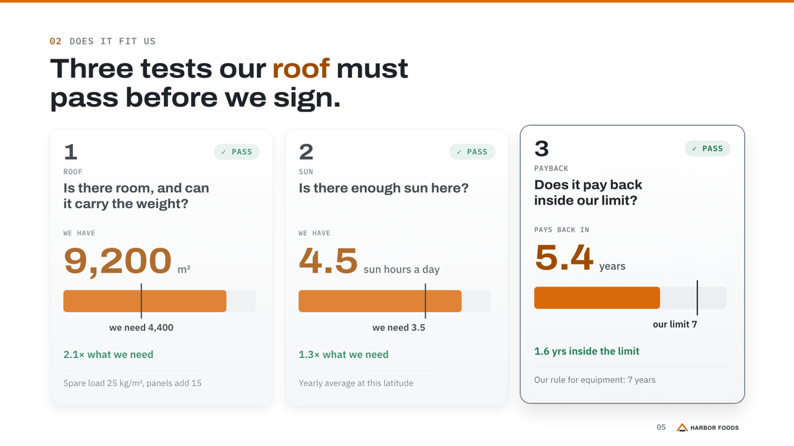

# PresentToMe

The storytelling method of Wai (Suppanimit Meemungkit), packaged as an agent skill: make a hard subject easy to understand by telling it as an interactive presentation.

It teaches a coding agent three things. Find the story first. Tell it in the shape of a martini glass: a narrow stem where the presenter leads one idea at a time, then a wide mouth where the audience explores. Use animation and design to extend understanding: raised white cards, colour that means something, motion on every key press, drawn visuals, 3D anatomy figures, and numbers the room can tune live. The result runs in a browser and ships as one offline HTML file.

It works in Claude Code, Codex, Cursor, Gemini CLI, GitHub Copilot and any other agent that reads [Agent Skills](https://agentskills.io).

[ภาษาไทย](README.th.md)


The slides on this page come from the example deck that ships with the skill. Its story and every figure in it are invented.

## What this pack does well

### 1. The story comes first

How a talk is told matters more than how it looks. A clear story on plain slides works. Fine slides with no story do not. So the pack starts with the story and makes every design choice serve it.

- **Grill with me.** Before any slide, the agent interviews you, one question at a time, each with its own best guess. It keeps asking until it knows who decides, what they should do, and the one sentence they should remember.
- **A Story Brief and a storyboard you approve.** Eight lines, then a slide list where every title is a claim and every slide names the picture that proves it.
- **The martini glass.** The stem comes first: you lead the room along one path, one idea and one press at a time, until everyone understands the same thing. Then the mouth opens: the audience asks, you move a slider or open an appendix page, and the deck answers. No control appears before the claim it tests has been made. The shape is the one Segel and Heer describe in [Narrative Visualization: Telling Stories with Data](https://idl.uw.edu/papers/narrative).
- **An arc that persuades.** The outside world before your proposal. The doubt answered before the money. The ask only after every number in it has been seen.
- **One press, one sentence.** Each key press reveals exactly what you say next, so the audience listens to you and does not read ahead.
- **Hard things made simple.** A concept slide before the slide that needs it, a physical picture for every abstract idea, and the honest limit stated out loud.

### 2. A design kit that makes the story visible

Six parts. The agent plans them into the storyboard and uses each one where it carries the point.

**Raised white cards.** One idea per card: a small tag, a short heading, one drawing, one line. The lifted-paper look gives the eye a place to rest and keeps a slide to three or four ideas.


**Colour with meaning.** Three colours, each with one meaning for the whole deck. Here orange is what we own, blue is the grid, purple is renting. By the tenth slide the audience reads the colour and needs no legend.


**Animation that extends understanding.** Lines draw, bars grow, a tank fills, parts lift apart. Each movement shows an order or a cause that a still picture would leave the audience to work out. Nothing moves for decoration.

**Drawn visuals.** Charts from your data and diagrams of the real mechanism. Thirty slide patterns: cost lines that cross, test strips, tanks and gauges, timelines, an approval list that ticks itself, a film opener.

| | |
|---|---|
|  |  |

**3D anatomy.** A thin-line isometric drawing of the real thing, with parts that light up and move apart. The audience sees what is being bought or built.


**Parameters you can tune live.** This is the mouth of the martini glass. Sliders on the assumptions the audience doubts. One model file owns every number, so when a slider moves, the chart, the tiles and every later slide follow. A question in the room is answered on the screen.


### 3. The plumbing that keeps it honest

- **One home for every number.** Slides bind to a model file. Options are compared like with like. Sources are collected into an appendix by the build.
- **A build that reports mistakes** and a browser check that opens every slide at every press and fails on errors, clipped text and content that leaves the stage.
- **Speaker notes written to be spoken,** one paragraph per press, a presenter window for a second screen, and one HTML file that runs with no network.
- **A deck memory.** `DECK.md` holds the brief, the colour dictionary and a log of your decisions, so the next session continues where this one stopped.

## Install

**Any agent, with the `skills` CLI**

```bash
npx skills add consciencex/PresentToMe
```

Add `-g` to install for your user account, and `-a <agent>` to pick one agent (`claude-code`, `codex`, `cursor`, `gemini-cli`, `github-copilot`, `opencode`, `amp`, `goose`, `windsurf`).

**Claude Code, as a plugin**

```
/plugin marketplace add consciencex/PresentToMe
/plugin install present-to-me@presenttome
```

**Codex**

```bash
npx skills add consciencex/PresentToMe -a codex -g
```

**Gemini CLI**

```bash
gemini skills install https://github.com/consciencex/PresentToMe.git --path skills/present-to-me
```

**By hand.** Copy the folder `skills/present-to-me` into your agent's skills folder: `~/.claude/skills/` for Claude Code, `~/.agents/skills/` for Codex and most others.

Requirements: Node.js 20 or later. The automated check and the screenshot tools use Playwright with Chromium, installed in the deck folder.

## Use

Ask for a presentation in your own words.

> Make a 15-minute deck for our board on moving the warehouse to solar. The quote and last year's bills are in ./docs.

> I need to explain our new pricing to the sales team on Friday. Grill me first.

> Turn this report into slides for the CEO. English slides, I will speak Thai.

The agent reads what you gave it, asks its questions, shows you the brief and the slide list, then builds chapter by chapter and shows you screenshots as it goes.

To try the example deck yourself:

```bash
node skills/present-to-me/scripts/new-deck.mjs ./example-deck --example
cd example-deck
npm install
npm run dev        # http://localhost:5173
```

## What is in the skill

```
skills/present-to-me/
├── SKILL.md                        story first, the design kit, the workflow, the rules
├── references/
│   ├── grill-with-me.md            the interview and the Story Brief
│   ├── story.md                    the arc, devices, titles, explaining hard things simply
│   ├── slide-patterns.md           thirty patterns: layout, presses, technique, what goes wrong
│   ├── visual-style.md             raised cards, colour, type, what reads as machine-made
│   ├── motion-and-interaction.md   presses in any order, timings, live numbers
│   ├── numbers-and-comparisons.md  one home for every number, like with like, live calculators
│   ├── anatomy-3d.md               isometric figures: writing a scene, camera rules, placing it
│   ├── logos-and-sources.md        real logos used properly, source lines, the registry
│   ├── notes-and-presenting.md     speaker notes, second-language scripts, rehearsal, film openers
│   ├── build-check-ship.md         commands, build messages, the check, fonts, publishing, privacy
│   └── pitfalls.md                 what went wrong on real decks, and what to do
├── scripts/new-deck.mjs            starts a blank deck, or a copy of the example
└── assets/starter/                 the engine, tools, templates, and a complete example deck
```

## Where it comes from

The method is Wai's. The pack was distilled from building one long executive deck with it over several weeks: 75 slides, many rounds of correction from the person presenting it, and a growing list of what worked and what did not. The story method, the design kit and the pitfalls here are that list, with the confidential content removed and the engine rewritten as a general starter.

## Credits

- Isometric figures use a vendored subset of [Anatomy](https://github.com/wheresryan22/anatomy) by Ryan (MIT). For detailed illustration, install Anatomy itself.
- The default typefaces are Archivo, IBM Plex Sans and IBM Plex Mono (SIL Open Font License), loaded from Google Fonts.
- See [THIRD_PARTY_NOTICES.md](THIRD_PARTY_NOTICES.md).

## Licence

MIT. See [LICENSE](LICENSE).
