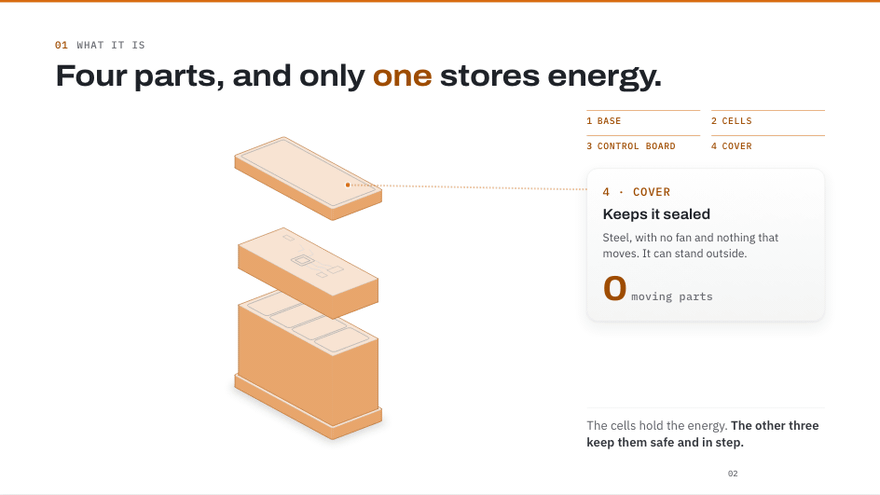
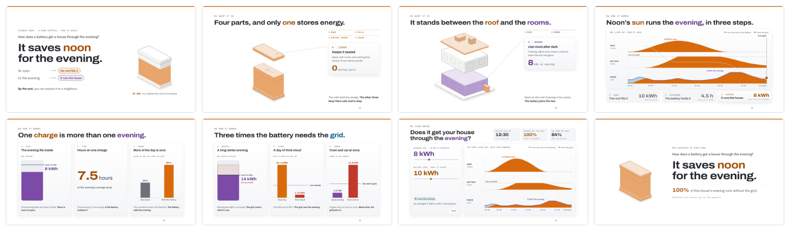
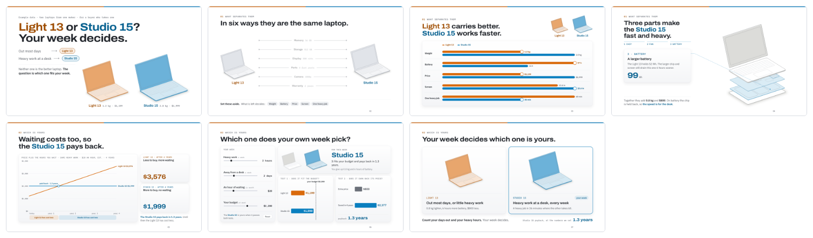
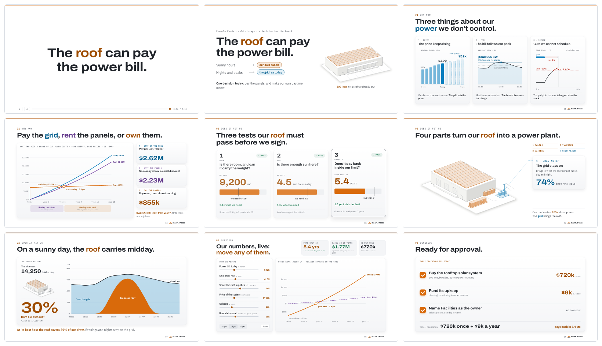
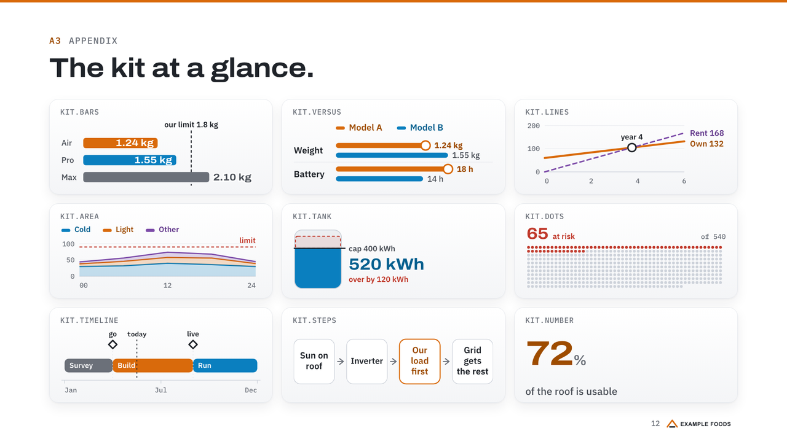
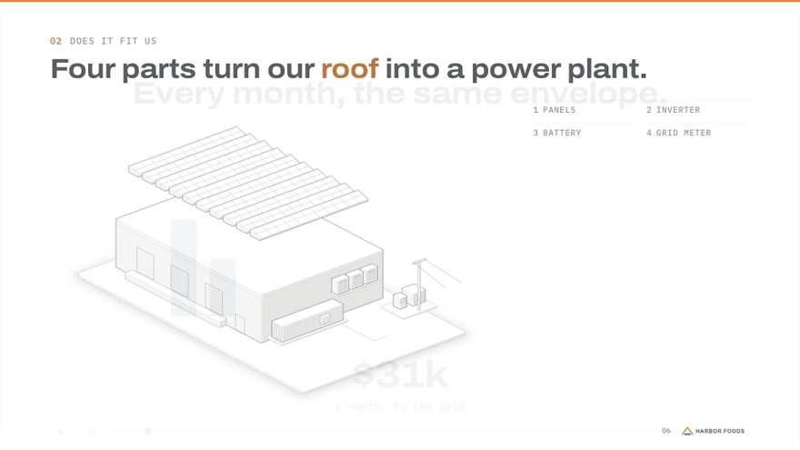
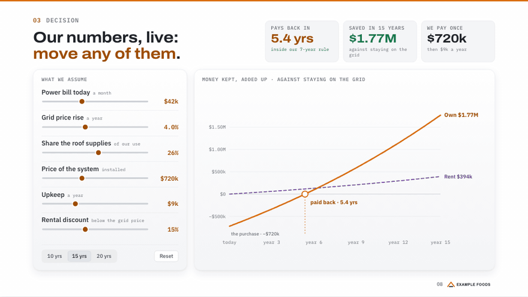

# PresentToMe

**PresentToMe คือหลักการเล่าเรื่องของ หวาย (Suppanimit Meemungkit) ที่ทำเรื่องยากให้เข้าใจง่าย ด้วยการเล่าผ่าน interactive presentation**

หลักการนี้ถูกรวบรวมเป็น agent skill ให้ AI agent อย่าง Claude Code, Codex, Cursor, Gemini CLI หรือ GitHub Copilot ใช้สร้าง presentation ให้คุณ หัวใจมีสามข้อ

1. **หาเรื่องที่จะเล่าให้เจอก่อน** agent สัมภาษณ์คุณก่อนสร้างสไลด์ จนรู้ว่าผู้ฟังคือใคร อยากให้เขาเข้าใจหรือตัดสินใจอะไร และประโยคเดียวที่อยากให้เขาจำคืออะไร
2. **เล่าแบบ martini glass** ช่วงแรกผู้เล่าพาผู้ฟังเดินตามเส้นเรื่องเดียว ทีละประเด็น ทีละการกด เหมือนก้านแก้วที่แคบและตรง เมื่อทุกคนเข้าใจตรงกันแล้ว เรื่องจึงเปิดกว้างเหมือนปากแก้ว ผู้ฟังถามได้ ปรับตัวเลขได้ และสำรวจรายละเอียดเองได้
3. **ให้การออกแบบช่วยอธิบาย** กล่องขาวนูน สีที่มีความหมาย การเคลื่อนไหวทุกครั้งที่กด กราฟที่วาดจากข้อมูล ภาพ 3D ที่แยกชิ้นส่วนให้ดู ตัวเลขที่ปรับได้สดๆ และวัตถุที่เคลื่อนจากสไลด์หนึ่งเข้าไปอยู่ในสไลด์ถัดไป

ผลลัพธ์เปิดได้ในเบราว์เซอร์ และส่งต่อได้เป็นไฟล์ HTML ไฟล์เดียวที่ใช้งานได้โดยไม่ต้องต่ออินเทอร์เน็ต

[English](README.md)



ภาพทุกภาพในหน้านี้มาจาก deck ที่มากับ skill เรื่องและตัวเลขทั้งหมดเป็นข้อมูลสมมติ

## เริ่มจาก deck ที่ทำเสร็จแล้ว

เวอร์ชัน 1.0 ให้ agent เริ่มจาก deck เปล่ากับคู่มือสิบเอ็ดฉบับ เมื่อผู้ใช้สั่งงานสั้นๆ บรรทัดเดียว agent มักได้สไลด์ที่มีแต่ข้อความในกล่อง เวอร์ชัน 1.1 จึงให้ agent เริ่มจาก deck ที่ทำเสร็จแล้วตามชนิดของงาน องค์ประกอบทุกอย่างต่อไว้ครบและเคลื่อนไหวได้จริง agent มีหน้าที่เล่าใหม่ด้วยเรื่องของคุณ

| ชนิด | เหมาะกับคำสั่งแบบ | สิ่งที่มีมาให้ตั้งแต่ต้น |
|---|---|---|
| `explainer` | "อธิบายว่า X ทำงานอย่างไร" "ทำสไลด์เรื่อง X" | ภาพ 3D ของสิ่งนั้น ชิ้นส่วนทีละชิ้นต่อการกด ตำแหน่งที่มันไปอยู่ ขั้นตอนการทำงาน ตัวเลข ข้อจำกัด และสไลด์ที่ผู้ฟังลองปรับเองได้ |
| `versus` | "X หรือ Y" "X vs Y" | ของสองอย่างวางคู่กัน สิ่งที่เหมือนกัน แถวที่ต่างกัน ความต่างข้างใน ต้นทุนตามเวลา ตัวช่วยเลือก และข้อสรุป |
| `decision` | "ขออนุมัติเรื่องนี้" | ฟิล์มเปิดเรื่อง ทำไมต้องตอนนี้ ทางเลือกบนฐานเดียวกัน บททดสอบ วิธีทำงาน ตัวเลขเงินที่ปรับได้ และหน้าขออนุมัติ |
| `blank` | งานที่ไม่เข้าสามแบบข้างบน | หน้า title หน้าคำถาม หน้าแหล่งข้อมูล และ template สำหรับสร้างส่วนที่เหลือ |







## วิธีเล่าสำคัญที่สุด

วิธีเล่ามีผลมากกว่าความสวย skill นี้จึงเริ่มที่เรื่องก่อน แล้วให้การออกแบบทุกอย่างรับใช้เรื่อง

- **Grill with me** ก่อนสร้างสไลด์ agent จะถามคุณทีละคำถาม พร้อมคำตอบที่มันคาดไว้ให้ จนรู้ชัดว่าใครเป็นคนตัดสินใจ อยากให้เขาทำอะไร และประโยคเดียวที่อยากให้เขาจำคืออะไร
- **Story Brief และ storyboard ที่คุณอนุมัติก่อน** brief แปดบรรทัด ตามด้วยรายการสไลด์ที่ทุกหัวข้อเป็นข้อสรุป และทุกสไลด์ระบุภาพที่ใช้พิสูจน์
- **Martini glass** ก้านแก้วมาก่อน คุณพาทั้งห้องเดินตามเส้นเรื่องเดียวจนเข้าใจตรงกัน จากนั้นปากแก้วจึงเปิด ผู้ฟังถาม คุณเลื่อน slider หรือเปิดหน้า appendix แล้ว deck เป็นฝ่ายตอบ จะไม่มีปุ่มหรือ slider ใดขึ้นมาก่อนที่ข้อสรุปของมันจะถูกเล่า โครงนี้มาจากงานวิจัยของ Segel และ Heer เรื่อง [Narrative Visualization: Telling Stories with Data](https://idl.uw.edu/papers/narrative)
- **ลำดับเรื่องของงานแต่ละชนิด** งานอธิบายเล่าจากภายนอกของสิ่งนั้น เข้าไปข้างใน แล้วจบที่การใช้งาน งานเปรียบเทียบตัดทุกอย่างที่ไม่ได้แยกสองตัวเลือกออกจากกัน งานขออนุมัติเล่าโลกภายนอกก่อนข้อเสนอ และขออนุมัติหลังจากผู้ฟังเห็นตัวเลขครบทุกตัวแล้ว
- **กดหนึ่งครั้ง พูดหนึ่งประโยค** การกดแต่ละครั้งเผยเฉพาะสิ่งที่คุณกำลังจะพูด ผู้ฟังจึงฟังคุณ ไม่อ่านล่วงหน้า

## ชุดออกแบบ

มีเจ็ดอย่าง แต่ละอย่างมีวิธีสร้างสำเร็จรูป agent จึงใช้แรงไปกับเรื่องของคุณ

**กล่องขาวนูน** หนึ่งกล่องต่อหนึ่งความคิด มีป้ายเล็ก หัวข้อสั้น ภาพวาดหนึ่งภาพ และข้อความสรุปหนึ่งบรรทัด


**สีที่มีความหมาย** ใช้สามสี แต่ละสีมีความหมายเดียวตลอดทั้ง deck หัวข้อ เส้นกราฟ และภาพ 3D ใช้สามสีเดียวกัน กราฟจึงไม่ต้องมีคำอธิบายสี

**การเคลื่อนไหวทุกครั้งที่กด** เส้นกราฟค่อยๆ วาด แท่งค่อยๆ โต ถังค่อยๆ เต็ม ชิ้นส่วนแยกออกให้เห็นข้างใน การเคลื่อนไหวแต่ละครั้งบอกลำดับหรือเหตุผลที่ภาพนิ่งบอกไม่ได้

**ภาพที่วาดจากข้อมูล** มี chart สำเร็จรูปเก้าแบบในสไตล์เดียวกัน เคลื่อนไหวได้ และใช้โค้ดไม่กี่บรรทัด ได้แก่ แท่งเปรียบเทียบ แถว versus เส้นที่ตัดกัน พื้นที่ซ้อน ถัง จุด timeline ขั้นตอน และตัวเลขใหญ่หนึ่งตัว



**3D anatomy** ภาพลายเส้นแบบ isometric ของของจริง ชิ้นส่วนสว่างขึ้นและแยกออกทีละชิ้นต่อการกด มี preset แปดแบบที่ครอบคลุมเรื่องส่วนใหญ่ ได้แก่ laptop โทรศัพท์ เคสคอมพิวเตอร์ ตู้ rack อาคาร กล่องสินค้า ทรงกระบอก และชั้นซ้อน



**ตัวเลขที่ปรับได้สดๆ** นี่คือปากแก้วของ martini glass ไฟล์ model ไฟล์เดียวเป็นเจ้าของตัวเลขทุกตัว เมื่อเลื่อน slider กราฟ ตัวเลขสรุป และสไลด์ถัดไปทุกหน้าจะเปลี่ยนตาม


**ความต่อเนื่อง** วัตถุหรือตัวเลขเดียวกันเคลื่อนจากสไลด์หนึ่งเข้าไปอยู่ในสไลด์ถัดไป คล้าย transition แบบ Morph เครื่องบนสไลด์หนึ่งเคลื่อนเข้าไปอยู่ในห้องบนสไลด์ถัดไป ตัวเลขที่คำนวณบนสไลด์หนึ่งกลายเป็นบรรทัดของหน้าขออนุมัติ ทั้งเรื่องจึงไหลเป็นเส้นเดียว



## ตัวตรวจที่รักษามาตรฐาน

`npm run check` เปิดทุกสไลด์ทุกการกดในเบราว์เซอร์จริง ถ้าพบ script error ไฟล์หาย ข้อความถูกตัด หรือเนื้อหาล้นจอ จะไม่ผ่าน นอกจากนั้นยังวัดองค์ประกอบของชุดออกแบบ ถ้า deck ขาดองค์ประกอบก็ไม่ผ่านเช่นกัน

| กฎ | สิ่งที่วัด |
|---|---|
| ทุกสไลด์มีภาพ | ภาพวาดหรือภาพ 3D ที่กินพื้นที่จอตั้งแต่ 6% ขึ้นไป |
| รูปถ่ายเป็นหลักฐาน | สไลด์ที่มีแต่รูปถ่ายมีได้ไม่เกินสองหน้า |
| deck มีภาพ 3D | มีอย่างน้อยหนึ่งภาพ |
| ผู้ฟังปรับอะไรบางอย่างได้ | มี slider ตัวเลือก หรือปุ่มเลือก |
| มีสิ่งที่เคลื่อนข้ามสไลด์ | นับจาก Morph ที่เคลื่อนจริงในเบราว์เซอร์ |
| ทุกการกดทำให้ภาพเคลื่อนไหว | สไลด์ที่มีการกดต้องมี hook หรือ chart สำเร็จรูป |
| คงสไตล์ของชุดออกแบบ | ไม่มีสไลด์พื้นมืด และมีการใช้กล่องขาวนูน |

ถ้ากฎข้อใดไม่เข้ากับ deck จริงๆ ปิดกฎข้อนั้นได้ใน config ของ deck โดยต้องเขียนเหตุผลกำกับ และ agent ถูกกำหนดให้แจ้งคุณทุกข้อที่ปิด

## ติดตั้ง

**agent ใดก็ได้ ด้วย `skills` CLI**

```bash
npx skills add consciencex/PresentToMe
```

เติม `-g` เพื่อติดตั้งระดับผู้ใช้ และ `-a <agent>` เพื่อเลือก agent ตัวเดียว (`claude-code`, `codex`, `cursor`, `gemini-cli`, `github-copilot`, `opencode`, `amp`, `goose`, `windsurf`)

**Claude Code แบบ plugin**

```
/plugin marketplace add consciencex/PresentToMe
/plugin install present-to-me@presenttome
```

**Codex**

```bash
npx skills add consciencex/PresentToMe -a codex -g
```

**Gemini CLI**

```bash
gemini skills install https://github.com/consciencex/PresentToMe.git --path skills/present-to-me
```

**ติดตั้งเอง** คัดลอกโฟลเดอร์ `skills/present-to-me` ไปไว้ในโฟลเดอร์ skills ของ agent เช่น `~/.claude/skills/` สำหรับ Claude Code หรือ `~/.agents/skills/` สำหรับ Codex และ agent ส่วนใหญ่

สิ่งที่ต้องมี: Node.js 20 ขึ้นไป ตัวตรวจและเครื่องมือถ่ายภาพหน้าจอใช้ Playwright กับ Chromium ซึ่งติดตั้งในโฟลเดอร์ของ deck

## วิธีใช้

สั่งเป็นภาษาของคุณได้เลย

> อธิบายว่า heat pump ทำงานอย่างไรให้เจ้าของบ้านฟัง สิบนาที สไลด์ภาษาไทย

> ทำสไลด์เปรียบเทียบ laptop สองรุ่นของเราให้ทีมขาย

> ทำ deck 15 นาทีให้บอร์ด เรื่องย้ายโกดังไปใช้โซลาร์ ใบเสนอราคาและบิลปีที่แล้วอยู่ใน ./docs

agent จะอ่านสิ่งที่คุณให้ ถามคำถาม เสนอ brief กับรายการสไลด์ให้คุณดู แล้วเล่า deck ใหม่ทีละสไลด์ พร้อมส่งภาพหน้าจอให้ดูระหว่างทาง

ถ้าอยากเปิด deck ดูเอง

```bash
node skills/present-to-me/scripts/new-deck.mjs ./my-deck --kind explainer --lang th
cd my-deck
npm install
npm run dev        # http://localhost:5173
```

`--lang th` เพิ่มฟอนต์ไทย (IBM Plex Sans Thai) และระยะบรรทัดที่เหมาะกับภาษาไทยให้

ปุ่มที่ใช้: → ถัดไป ← ย้อนกลับ N โน้ตผู้พูด M เมนู P หน้าต่างผู้นำเสนอ F เต็มจอ

## เครื่องมือทำอะไรกับเครื่องของคุณบ้าง

skill นี้ผ่านการตรวจด้านความปลอดภัยก่อนเผยแพร่ และเครื่องมือมีชุดทดสอบอยู่ใน `tests/`

- deck ไม่มี dependency ตอนใช้งานจริง `npm install` เพิ่มเฉพาะ Playwright ที่ล็อกเวอร์ชันไว้ สำหรับตัวตรวจและภาพหน้าจอ agent ถูกกำหนดให้ถามคุณก่อนติดตั้งหรือดาวน์โหลดเบราว์เซอร์
- หน้าพรีวิวและตัวตรวจเปิดให้เข้าถึงจากเครื่องนี้เท่านั้น (127.0.0.1) และส่งเฉพาะไฟล์ในโฟลเดอร์ build
- build ไม่ล้างโฟลเดอร์ ลบเฉพาะไฟล์ที่ตัวเองเขียนไว้ครั้งก่อน และปฏิเสธโฟลเดอร์ที่มีไฟล์อื่นอยู่
- `new-deck.mjs` เขียนลงโฟลเดอร์ใหม่หรือโฟลเดอร์ว่างเท่านั้น
- โน้ตผู้พูดอยู่ใน `dist/` เท่านั้น `npm run build:public` สร้างสำเนาที่ไม่มีโน้ตไว้ใน `public-build/` สำหรับส่งให้คนอื่นเปิด
- เครื่องมือฟอนต์ดาวน์โหลดจาก Google Fonts ผ่าน https เท่านั้น และ skill ไม่มีโลโก้ของบริษัทอื่นติดมาด้วย
- agent ถูกกำหนดไม่ให้ commit เผยแพร่ หรือส่งอะไรออกไป ถ้าคุณไม่ได้สั่ง

## ใน skill มีอะไรบ้าง

```
skills/present-to-me/
├── SKILL.md                        ชนิดของ deck ชุดออกแบบ มาตรฐาน ขั้นตอนทำงาน และกฎ
├── references/
│   ├── grill-with-me.md            การสัมภาษณ์และ Story Brief
│   ├── story.md                    ลำดับเรื่อง martini glass ความต่อเนื่อง การตั้งหัวข้อ
│   ├── kit-components.md           chart สำเร็จรูปเก้าแบบ พร้อมตัวอย่าง
│   ├── slide-patterns.md           รูปแบบสไลด์ 35 แบบ
│   ├── anatomy-3d.md               ภาพ 3D: preset, Kit.figure, การเขียน scene
│   ├── motion-and-interaction.md   การกดแบบข้ามลำดับ Morph จังหวะเวลา ตัวเลขสด
│   ├── visual-style.md             กล่องขาวนูน สี ตัวอักษร การคงสไตล์
│   ├── numbers-and-comparisons.md  ตัวเลขมีที่อยู่เดียว เปรียบเทียบบนฐานเดียวกัน
│   ├── logos-and-sources.md        การใช้โลโก้จริง บรรทัดแหล่งที่มา ทะเบียนแหล่งข้อมูล
│   ├── notes-and-presenting.md     โน้ตผู้พูด สคริปต์ภาษาที่สอง การซ้อม ฟิล์มเปิดเรื่อง
│   ├── build-check-ship.md         คำสั่ง ข้อความจาก build ตัวตรวจและกฎ การแชร์ ความเป็นส่วนตัว
│   └── pitfalls.md                 สิ่งที่เคยพลาดใน deck จริง และวิธีแก้
├── scripts/new-deck.mjs            เริ่ม deck ตามชนิดที่เลือก
└── assets/
    ├── starter/                    engine ชุด chart เครื่องมือ template และ deck แบบ decision
    └── recipes/                    deck แบบ explainer และ versus
```

## ที่มา

หลักการเป็นของหวาย skill นี้กลั่นมาจากการทำ deck ผู้บริหารขนาดยาวหนึ่งชุดตลอดหลายสัปดาห์ จำนวน 75 สไลด์ ผ่านการแก้ตามคำติของผู้นำเสนอหลายรอบ และจดไว้ตลอดว่าอะไรได้ผล อะไรไม่ได้ผล วิธีเล่าเรื่อง ชุดออกแบบ และข้อผิดพลาดที่รวมไว้ที่นี่มาจากบันทึกนั้น โดยตัดเนื้อหาที่เป็นความลับออก และเขียน engine ใหม่ให้ใช้ได้กับงานทั่วไป

## เครดิต

- ภาพ isometric ใช้ส่วนหนึ่งของ [Anatomy](https://github.com/wheresryan22/anatomy) โดย Ryan (MIT) ถ้าต้องการภาพประกอบที่ละเอียดกว่านี้ ดูที่ Anatomy โดยตรง
- ฟอนต์เริ่มต้นคือ Archivo, IBM Plex Sans และ IBM Plex Mono (SIL Open Font License) โหลดจาก Google Fonts ส่วน deck ภาษาไทยเพิ่ม IBM Plex Sans Thai
- ดู [THIRD_PARTY_NOTICES.md](THIRD_PARTY_NOTICES.md)

## สัญญาอนุญาต

MIT ดู [LICENSE](LICENSE)
