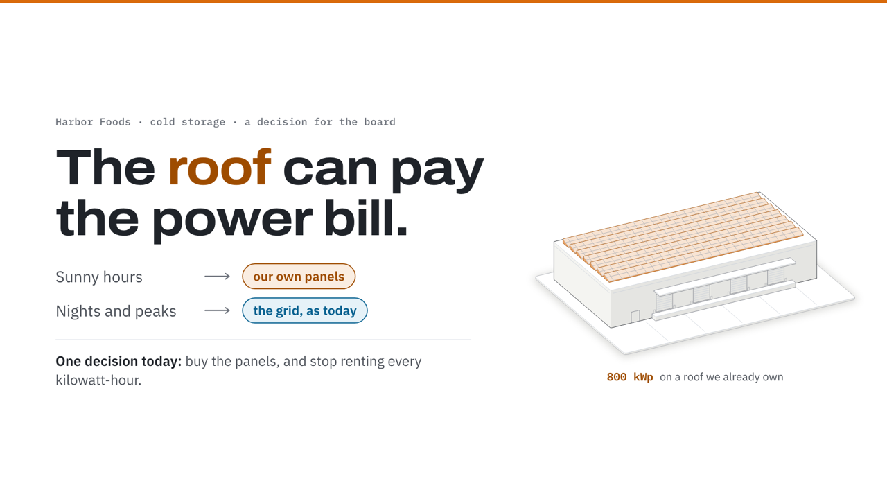

# PresentToMe

Agent skill สำหรับสร้าง presentation ที่คนฟังตามทัน เริ่มจากเรื่องเล่าก่อน แล้วจึงสร้างสไลด์ที่เผยทีละอย่างต่อการกดหนึ่งครั้ง มีกราฟที่วาดจากโมเดลตัวเลขจริง ภาพ 3D แบบ isometric โลโก้จริง โน้ตผู้พูด และไฟล์ HTML ไฟล์เดียวที่เปิดได้โดยไม่ต้องต่ออินเทอร์เน็ต

ใช้ได้กับ Claude Code, Codex, Cursor, Gemini CLI, GitHub Copilot และ agent อื่นที่อ่าน [Agent Skills](https://agentskills.io)

[English](README.md)



ภาพข้างบนมาจาก deck ตัวอย่างที่มากับ skill เรื่องและตัวเลขทั้งหมดในตัวอย่างเป็นข้อมูลสมมติ

## สิ่งที่ได้

- **Grill with me** ก่อนสร้างสไลด์ agent จะสัมภาษณ์คุณทีละคำถาม พร้อมคำตอบที่มันเดาไว้ให้ จนชัดว่าใครฟัง จะให้เขาตัดสินใจอะไร และประโยคเดียวที่อยากให้จำคืออะไร คุณอนุมัติ Story Brief และรายการสไลด์ก่อนเริ่มสร้าง
- **Deck ที่รันในเบราว์เซอร์** หนึ่งสไลด์ต่อหนึ่งไฟล์ บนเวที 1920 × 1080 กด → เพื่อเผยสิ่งถัดไป กด N ดูโน้ต กด P เปิดหน้าต่างผู้พูด กด M เปิดเมนู
- **ภาพที่เล่าแทนตัวหนังสือ** รูปแบบสไลด์ 30 แบบ เช่น การ์ดยกที่มีภาพวาดหนึ่งภาพต่อการ์ด เส้นต้นทุนที่ตัดกัน แถบการทดสอบ ถัง มาตรวัด ภาพแยกชิ้นส่วน calculator ที่ปรับได้สด หน้าขออนุมัติที่ติ๊กเอง และหนังเปิดเรื่อง
- **ตัวเลขที่ตอบคำถามได้** ไฟล์โมเดลไฟล์เดียวเป็นเจ้าของตัวเลขทุกตัว สไลด์ผูกกับโมเดล slider เปลี่ยนค่าในโมเดล และสไลด์ถัดไปเปลี่ยนตาม ส่วนแหล่งอ้างอิงถูกรวบไปไว้ที่ appendix ตอน build
- **ภาพ isometric 3D** ภาพลายเส้นของของจริง มีชิ้นส่วนที่สว่างขึ้นและแยกออกจากกันได้
- **การตรวจ** build ที่รายงานข้อผิดพลาด และ check ที่เปิดทุกสไลด์ทุกการกดในเบราว์เซอร์จริง ถ้ามี error ตัวหนังสือถูกตัด หรือเนื้อหาล้นเวที จะไม่ผ่าน
- **ความจำของ deck** ไฟล์ `DECK.md` เก็บ brief พจนานุกรมสี และบันทึกการตัดสินใจของคุณ session ถัดไปจึงทำต่อได้ทันที

## ติดตั้ง

**ทุก agent ผ่าน `skills` CLI**

```bash
npx skills add consciencex/PresentToMe
```

เพิ่ม `-g` เพื่อติดตั้งระดับผู้ใช้ และ `-a <agent>` เพื่อเลือก agent (`claude-code`, `codex`, `cursor`, `gemini-cli`, `github-copilot`, `opencode`, `amp`, `goose`, `windsurf`)

**Claude Code แบบ plugin**

```
/plugin marketplace add consciencex/PresentToMe
/plugin install present-to-me@presenttome
```

**Codex**

```bash
npx skills add consciencex/PresentToMe -a codex -g
```

**ติดตั้งเอง** คัดลอกโฟลเดอร์ `skills/present-to-me` ไปไว้ในโฟลเดอร์ skills ของ agent เช่น `~/.claude/skills/` สำหรับ Claude Code หรือ `~/.agents/skills/` สำหรับ Codex และ agent ส่วนใหญ่

ต้องมี Node.js 20 ขึ้นไป การ check และการถ่ายภาพสไลด์ใช้ Playwright กับ Chromium ซึ่ง agent จะติดตั้งในโฟลเดอร์ deck เมื่อต้องใช้

## วิธีใช้

สั่งเป็นภาษาของคุณเอง

> ทำ deck 15 นาทีเสนอบอร์ดเรื่องติด solar ที่โกดัง ใบเสนอราคากับบิลค่าไฟปีที่แล้วอยู่ใน ./docs

> วันศุกร์ต้องอธิบายราคาใหม่ให้ทีมขาย ช่วย grill ผมก่อน

> แปลงรายงานนี้เป็นสไลด์เสนอ CEO สไลด์ภาษาอังกฤษ ผมจะพูดภาษาไทย

agent จะอ่านเอกสารที่ให้ ถามคำถาม ส่ง brief กับรายการสไลด์ให้คุณดู แล้วสร้างทีละบท พร้อมส่งภาพสไลด์ให้ดูระหว่างทาง

ลอง deck ตัวอย่าง

```bash
node skills/present-to-me/scripts/new-deck.mjs ./example-deck --example
cd example-deck
npm install
npm run dev        # http://localhost:5173
```

## ที่มา

skill นี้กลั่นมาจากการทำ deck เสนอผู้บริหารจริงหนึ่งชุด ยาว 75 สไลด์ ใช้เวลาหลายสัปดาห์ ผ่านการแก้ตามคำติของผู้นำเสนอหลายรอบ รูปแบบ กฎ และข้อผิดพลาดที่บันทึกไว้ใน skill คือบทเรียนจากงานนั้น โดยตัดเนื้อหาที่เป็นความลับออกทั้งหมด และเขียน engine ใหม่ให้เป็น starter ที่ใช้ได้กับทุกเรื่อง

## เครดิตและสัญญาอนุญาต

- ภาพ isometric ใช้ชุดเครื่องมือบางส่วนจาก [Anatomy](https://github.com/wheresryan22/anatomy) โดย Ryan (MIT)
- ฟอนต์เริ่มต้นคือ Archivo, IBM Plex Sans และ IBM Plex Mono (SIL Open Font License) โหลดจาก Google Fonts
- สัญญาอนุญาต MIT ดู [LICENSE](LICENSE) และ [THIRD_PARTY_NOTICES.md](THIRD_PARTY_NOTICES.md)
