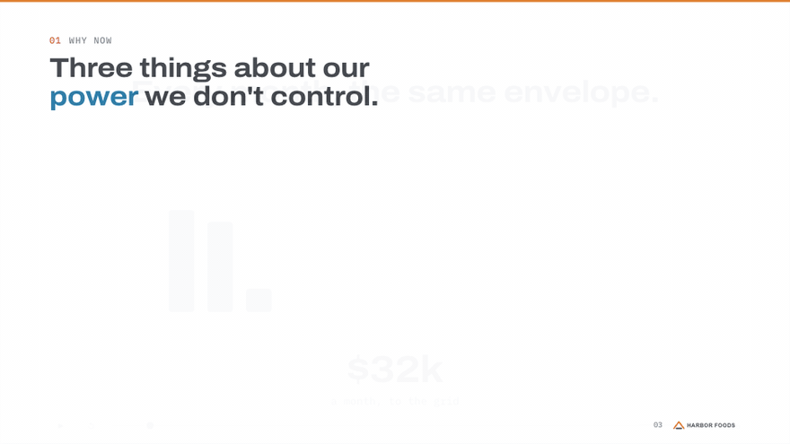
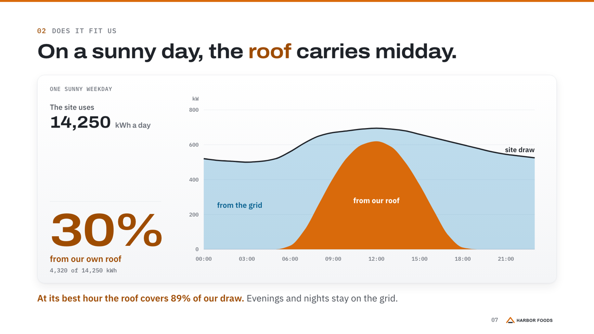

# PresentToMe

**PresentToMe คือหลักการสร้าง storytelling ของ หวาย (Suppanimit Meemungkit) ที่ทำเรื่องยากให้เป็นเรื่องเข้าใจง่าย ผ่าน interactive presentation**

หลักการนี้ถูกรวบรวมเป็น agent skill ให้ AI agent อย่าง Claude Code, Codex, Cursor, Gemini CLI หรือ GitHub Copilot นำไปใช้สร้าง presentation ให้คุณได้ หัวใจมีสามข้อ

1. **เล่าเรื่องแบบ martini glass** ช่วงแรกผู้เล่าพาผู้ฟังเดินตามเส้นเรื่องเส้นเดียว ทีละประเด็น ทีละการกด เหมือนก้านแก้วที่แคบและตรง เมื่อทุกคนเข้าใจตรงกันแล้ว เรื่องจึงเปิดกว้างเหมือนปากแก้ว ผู้ฟังถามได้ ปรับตัวเลขได้ และสำรวจรายละเอียดเองได้
2. **ใช้ interactive presentation แทนสไลด์นิ่ง** ผู้ฟังไม่ได้แค่นั่งดู ผู้ฟังได้ลองเอง เลื่อน slider แล้วเห็นจุดคุ้มทุนขยับทันที คำถามในห้องจึงได้คำตอบบนจอ
3. **ใช้ animation ขยายความเข้าใจ** เส้นกราฟค่อยๆ วาด ถังค่อยๆ เต็ม ชิ้นส่วนแยกออกให้เห็นข้างใน การเคลื่อนไหวแต่ละครั้งบอกลำดับและเหตุผลที่ภาพนิ่งบอกไม่ได้ และไม่มีการเคลื่อนไหวที่ใส่ไว้เพื่อความสวยอย่างเดียว

[English](README.md)


ภาพในหน้านี้มาจาก deck ตัวอย่างที่มากับ skill เรื่องและตัวเลขทั้งหมดในตัวอย่างเป็นข้อมูลสมมติ

## สิ่งที่ pack นี้ทำได้ดี

### 1. วิธีเล่าสำคัญที่สุด

เรื่องที่เล่าชัดบนสไลด์เรียบๆ ยังได้ผล แต่สไลด์สวยที่ไม่มีเรื่องเล่าไม่ได้ผล pack นี้จึงเริ่มที่เรื่องก่อน แล้วให้การออกแบบทุกอย่างรับใช้เรื่อง

- **Grill with me** ก่อนสร้างสไลด์ agent จะสัมภาษณ์คุณทีละคำถาม พร้อมคำตอบที่มันเดาไว้ให้ จนรู้ชัดว่าใครเป็นคนตัดสินใจ อยากให้เขาทำอะไร และประโยคเดียวที่อยากให้เขาจำคืออะไร
- **Story Brief และ storyboard ที่คุณอนุมัติก่อน** brief แปดบรรทัด ตามด้วยรายการสไลด์ที่ทุกหัวข้อเป็นข้อสรุป และทุกสไลด์ระบุภาพที่ใช้พิสูจน์
- **Martini glass** ก้านแก้วมาก่อน คุณพาทั้งห้องเดินตามเส้นเรื่องเดียวจนเข้าใจตรงกัน จากนั้นปากแก้วจึงเปิด ผู้ฟังถาม คุณเลื่อน slider หรือเปิดหน้า appendix แล้ว deck เป็นฝ่ายตอบ จะไม่มีปุ่มหรือ slider ใดโผล่มาก่อนที่ข้อสรุปของมันจะถูกเล่า โครงนี้มาจากงานวิจัยของ Segel และ Heer เรื่อง [Narrative Visualization: Telling Stories with Data](https://idl.uw.edu/papers/narrative)
- **ลำดับเรื่องที่โน้มน้าวได้** เล่าโลกภายนอกก่อนข้อเสนอของเรา ตอบข้อสงสัยก่อนพูดเรื่องเงิน และขออนุมัติหลังจากผู้ฟังเห็นตัวเลขทุกตัวมาแล้ว
- **กดหนึ่งครั้ง พูดหนึ่งประโยค** การกดแต่ละครั้งเผยเฉพาะสิ่งที่คุณกำลังจะพูด ผู้ฟังจึงฟังคุณ ไม่อ่านล่วงหน้า
- **เรื่องยากกลายเป็นเรื่องง่าย** มีสไลด์อธิบายแนวคิดก่อนสไลด์ที่ต้องใช้แนวคิดนั้น แนวคิดนามธรรมทุกอย่างมีภาพที่จับต้องได้ และบอกข้อจำกัดตรงๆ

### 2. ชุดออกแบบที่ทำให้เรื่องมองเห็นได้

มีหกอย่าง agent จะวางลงใน storyboard และใช้แต่ละอย่างตรงจุดที่มันช่วยเล่า

**กล่องขาวนูน** หนึ่งกล่องต่อหนึ่งความคิด มีป้ายเล็ก หัวข้อสั้น ภาพวาดหนึ่งภาพ และข้อความสรุปหนึ่งบรรทัด กล่องที่ยกขึ้นเหมือนแผ่นกระดาษทำให้สายตามีที่พัก และทำให้หนึ่งสไลด์มีแค่สามถึงสี่ความคิด



**สีที่มีความหมาย** ใช้สามสี แต่ละสีมีความหมายเดียวตลอดทั้ง deck ในตัวอย่างนี้ สีส้มคือสิ่งที่เราเป็นเจ้าของ สีฟ้าคือการไฟฟ้า สีม่วงคือการเช่า พอถึงสไลด์ที่สิบ ผู้ฟังอ่านสีออกโดยไม่ต้องมีคำอธิบาย


**Animation ที่ขยายความเข้าใจ** เส้นค่อยๆ วาด แท่งค่อยๆ โต ถังค่อยๆ เต็ม ชิ้นส่วนแยกออก การเคลื่อนไหวบอกลำดับและเหตุผล

**ภาพที่วาดจากของจริง** กราฟจากข้อมูลของคุณ และแผนภาพของกลไกจริง มีรูปแบบสไลด์ 30 แบบ เช่น เส้นต้นทุนที่ตัดกัน แถบการทดสอบ ถังและมาตรวัด timeline หน้าขออนุมัติที่ติ๊กเอง และหนังเปิดเรื่อง

| | |
|---|---|
|  |  |

**3D anatomy** ภาพ isometric ลายเส้นของของจริง มีชิ้นส่วนที่สว่างขึ้นและแยกออกจากกันได้ ผู้ฟังเห็นว่ากำลังจะซื้อหรือสร้างอะไร


**Parameter ที่ปรับได้สด** นี่คือปากแก้ว martini มี slider บนสมมติฐานที่ผู้ฟังสงสัย ไฟล์โมเดลไฟล์เดียวเป็นเจ้าของตัวเลขทุกตัว เมื่อเลื่อน slider กราฟ ตัวเลขสรุป และสไลด์ถัดไปทั้งหมดจะเปลี่ยนตาม


### 3. ระบบหลังบ้านที่ทำให้เชื่อถือได้

- **ตัวเลขทุกตัวมีที่อยู่ที่เดียว** สไลด์ผูกกับไฟล์โมเดล การเปรียบเทียบทางเลือกใช้ฐานเดียวกัน และแหล่งอ้างอิงถูกรวบไปไว้ที่ appendix ตอน build
- **build ที่รายงานข้อผิดพลาด** และ check ที่เปิดทุกสไลด์ทุกการกดในเบราว์เซอร์จริง ถ้ามี error ตัวหนังสือถูกตัด หรือเนื้อหาล้นเวที จะไม่ผ่าน
- **โน้ตผู้พูดที่เขียนให้พูดได้เลย** หนึ่งย่อหน้าต่อหนึ่งการกด มีหน้าต่างผู้พูดสำหรับจอที่สอง และไฟล์ HTML ไฟล์เดียวที่เปิดได้โดยไม่ต้องต่ออินเทอร์เน็ต
- **ความจำของ deck** ไฟล์ `DECK.md` เก็บ brief พจนานุกรมสี และบันทึกการตัดสินใจของคุณ session ถัดไปจึงทำต่อได้ทันที

## ติดตั้ง

**ทุก agent ผ่าน `skills` CLI**

```bash
npx skills add consciencex/PresentToMe
```

เพิ่ม `-g` เพื่อติดตั้งระดับผู้ใช้ และ `-a <agent>` เพื่อเลือก agent (`claude-code`, `codex`, `cursor`, `gemini-cli`, `github-copilot`, `opencode`, `amp`, `goose`, `windsurf`)

**Claude Code แบบ plugin**

```
/plugin marketplace add consciencex/PresentToMe
/plugin install present-to-me@presenttome
```

**Codex**

```bash
npx skills add consciencex/PresentToMe -a codex -g
```

**ติดตั้งเอง** คัดลอกโฟลเดอร์ `skills/present-to-me` ไปไว้ในโฟลเดอร์ skills ของ agent เช่น `~/.claude/skills/` สำหรับ Claude Code หรือ `~/.agents/skills/` สำหรับ Codex และ agent ส่วนใหญ่

ต้องมี Node.js 20 ขึ้นไป การ check และการถ่ายภาพสไลด์ใช้ Playwright กับ Chromium ซึ่งติดตั้งในโฟลเดอร์ deck

## วิธีใช้

สั่งเป็นภาษาของคุณเอง

> ทำ deck 15 นาทีเสนอบอร์ดเรื่องติด solar ที่โกดัง ใบเสนอราคากับบิลค่าไฟปีที่แล้วอยู่ใน ./docs

> วันศุกร์ต้องอธิบายราคาใหม่ให้ทีมขาย ช่วย grill ผมก่อน

> แปลงรายงานนี้เป็นสไลด์เสนอ CEO สไลด์ภาษาอังกฤษ ผมจะพูดภาษาไทย

agent จะอ่านเอกสารที่ให้ ถามคำถาม ส่ง brief กับรายการสไลด์ให้คุณดู แล้วสร้างทีละบท พร้อมส่งภาพสไลด์ให้ดูระหว่างทาง

ลอง deck ตัวอย่าง

```bash
node skills/present-to-me/scripts/new-deck.mjs ./example-deck --example
cd example-deck
npm install
npm run dev        # http://localhost:5173
```

## ที่มา

หลักการเป็นของหวาย pack นี้กลั่นมาจากการใช้หลักการนั้นทำ deck เสนอผู้บริหารจริงหนึ่งชุด ยาว 75 สไลด์ ใช้เวลาหลายสัปดาห์ และแก้ตามคำติของผู้นำเสนอหลายรอบ วิธีเล่าเรื่อง ชุดออกแบบ และข้อผิดพลาดที่บันทึกไว้ใน skill คือบทเรียนจากงานนั้น โดยตัดเนื้อหาที่เป็นความลับออกทั้งหมด และเขียน engine ใหม่ให้เป็น starter ที่ใช้ได้กับทุกเรื่อง

## เครดิตและสัญญาอนุญาต

- ภาพ isometric ใช้ชุดเครื่องมือบางส่วนจาก [Anatomy](https://github.com/wheresryan22/anatomy) โดย Ryan (MIT)
- ฟอนต์เริ่มต้นคือ Archivo, IBM Plex Sans และ IBM Plex Mono (SIL Open Font License) โหลดจาก Google Fonts
- สัญญาอนุญาต MIT ดู [LICENSE](LICENSE) และ [THIRD_PARTY_NOTICES.md](THIRD_PARTY_NOTICES.md)
